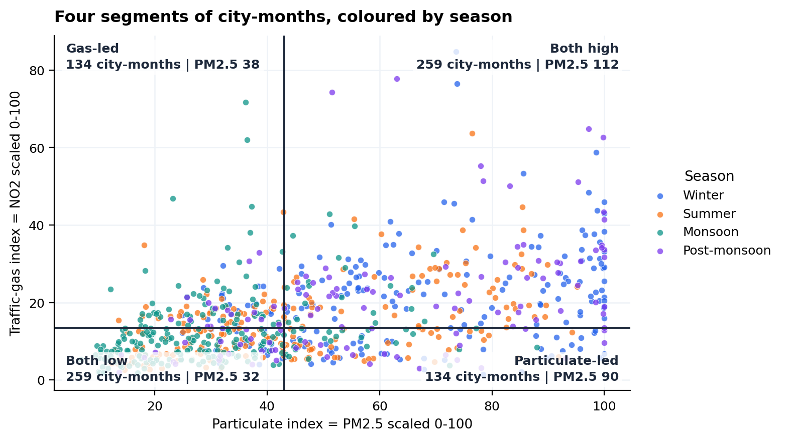
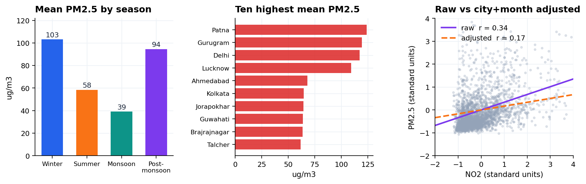
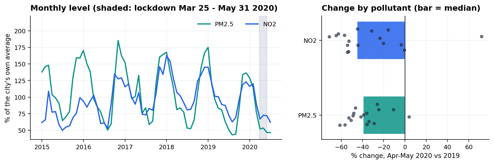

Air Quality in Indian Cities 2015 - 2020

Author: Kavish Singh Bisht B.Tech CSE (Data Science) V Semester, B K Birla Institute of Engineering and Technology.

Decision:

It cannot be determined what months had poor Air Quality due to particulate matter (PM2.5) and what months had poor Air Quality due to traffic gases (NO2). A single AQI value is therefore being considered to determine when action needs to be taken. This project provides a way to put both particulate matter and traffic gases on an equal scale from 0 to 100, categorises months and groups them into quartiles. The proportion of correlation between PM2.5 and NO2 due to seasonality and city will also be seen.

Dataset:

This dataset was taken from Kaggle, the original source is the Central Pollution Control Board (CPCB) Government of India. The dataset is from here: https://www.kaggle.com/rohanrao/air-quality-data-in-india by rohanrao. There is no clear license available so this dataset will not be redistributed. Only the file city_day.csv should be used.

Steps:

Create a virtual environment and run pip install -r requirements.txt.

Download the dataset from Kaggle, extract the files, then move the city_day.csv file into the data/ directory.

Open air_quality_project.ipynb in VS Code. Change Kernel to .venv and click Restart and Run All.

Images saved in /img/.

Data Quality:

Ahmedabad had issues with data quality. CO was simply a copy of NO (94.1% of rows were identical compared to 0.0-0.4% in other cities). CO has therefore been removed.

PM10 had too many missing values (36%) so PM10 was removed.

AQI had issues in Ahmedabad. It had 412 rows >500. It was based on CO rather than PM2.5. AQI has been removed for Ahmedabad. Any AQI >500 has been removed.

6 cities had less than 365 valid days so were excluded. 20 cities remain.

There are now 23652 city days.

Methodology:

2 separate indices were used. Particulate matter (PM2.5) and Traffic gases (NO2). Both were adjusted to be on a scale from 0-100. PM2.5 had a maximum of 120 and NO2 had a maximum of 180. This was a subjective decision.

PM2.5 and NO2 were adjusted to account for city and month using residualisation.

786 city-months were split into quartiles based on the median.

Comparison of lockdown period (April-May 2020) to April-May 2019 in 17 cities.

Results:

Average PM2.5 per season: Winter = 103, Post monsoon = 94, Summer = 58, Monsoon = 39 ug/m3.

The correlation between PM2.5 and NO2 dropped from 0.34 to 0.17 when accounting for city and month. City and month accounted for 43.2% of the variance in PM2.5 and 35.7% of NO2.

Months were gas driven, NO2 was 37.0 however average AQI was only 97. Both are low (NO2 = 14.3, AQI = 87).

During lockdown, PM2.5 had a median reduction of -39.0% however NO2 had a median reduction of -44.8%. In absolute terms, PM2.5 reduced by -19.9 and NO2 reduced by -10.3.

Limitations:

Secondary data. No health outcome. No causality.

AQI and PM2.5 (0.88) are related by definition.

Gas driven months were mostly during monsoon. So could be due to rain washing away PM2.5.

NO2 in Ahmedabad could not be validated.

Means of cities were taken over different periods.

No control for weather during lockdown. Percent and absolute figures show different order of pollution.

Subjective decisions made regarding indices and medians.
